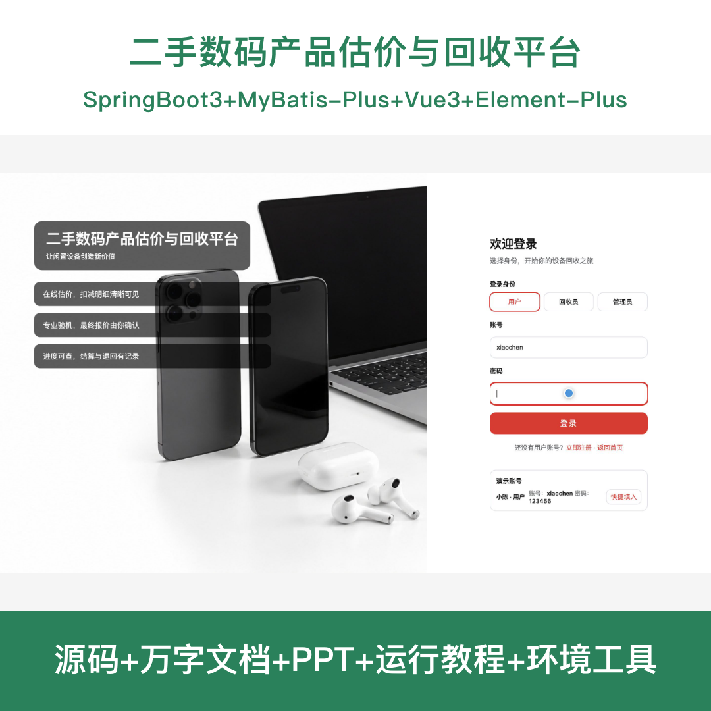
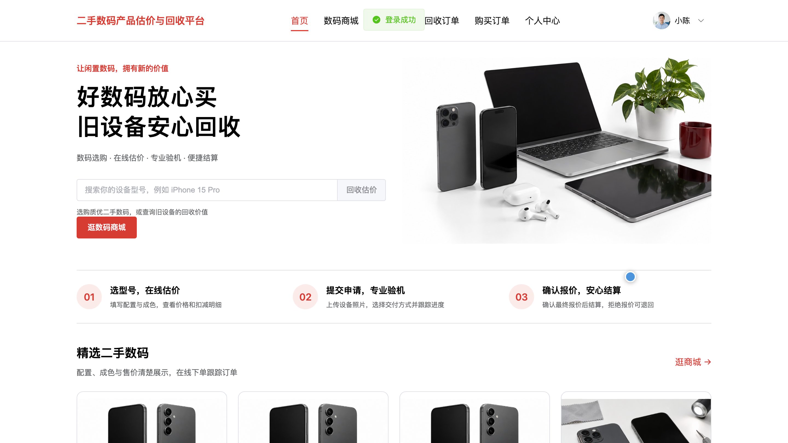
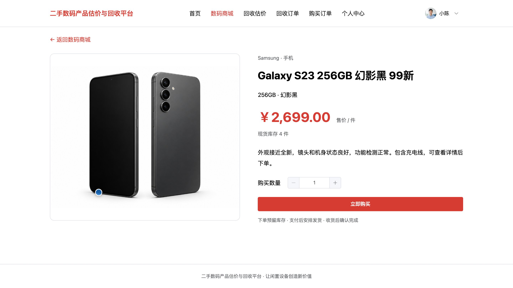
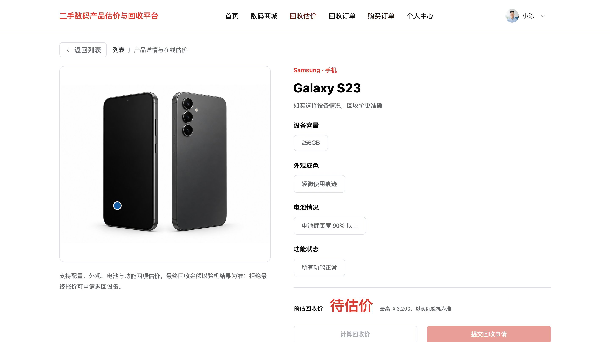
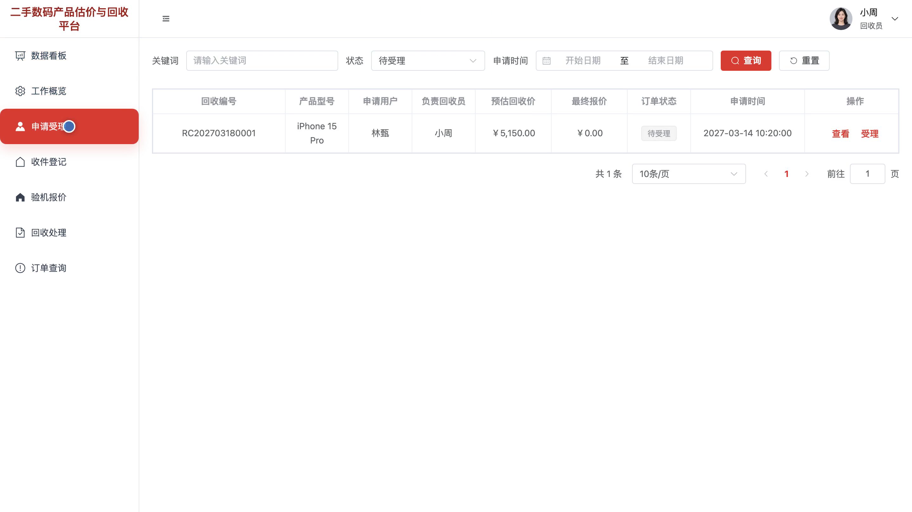
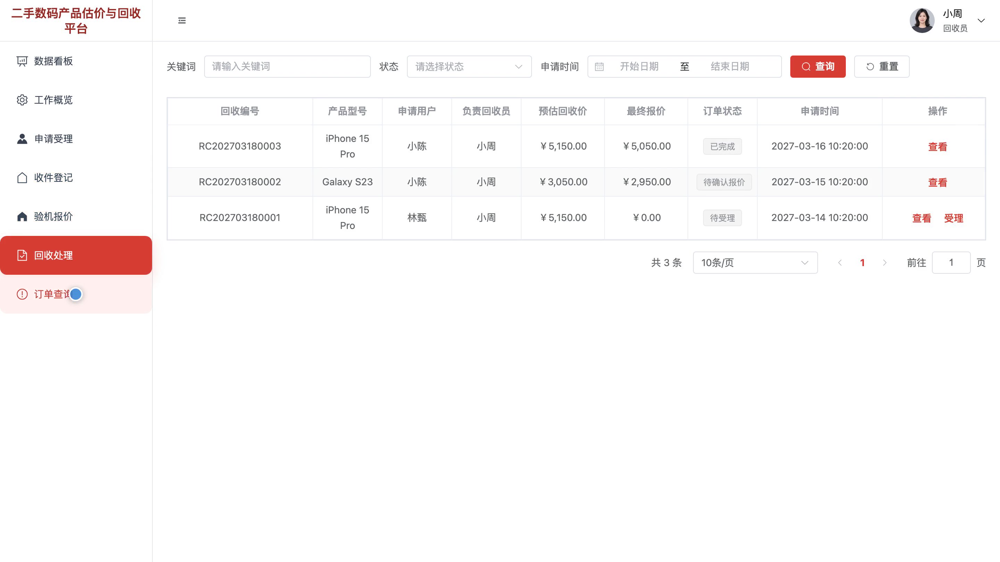
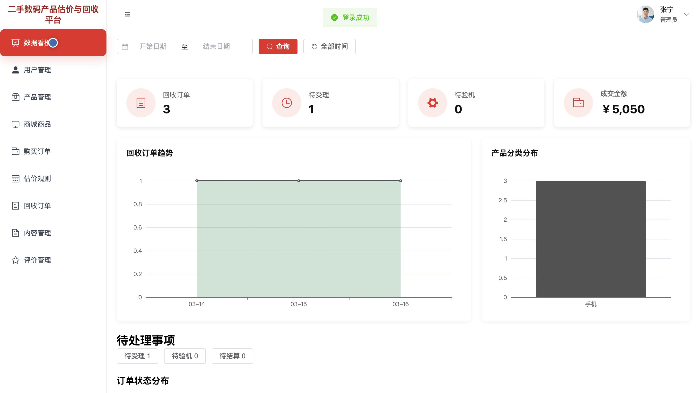
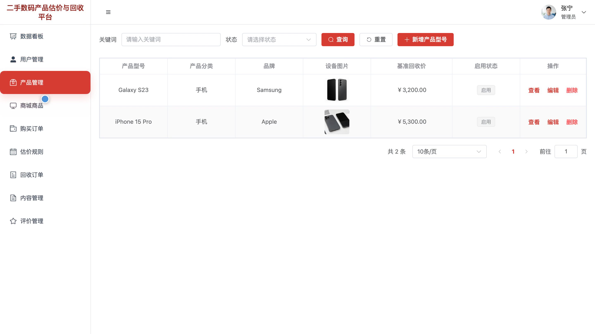

# bs154A
bs154A二手数码产品估价与回收平台系统源码 Java SpringBoot3 Vue3
## 源码问题查看主页咨询

### 一、关键词
二手数码回收、旧手机估价、闲置电子产品回收、数码产品交易、回收订单管理

### 二、作品包含
源码+数据库+全套环境和工具资源+本地部署教程

### 三、项目技术
前端技术： Html、Css、Js、Vue3.4、Element-Plus
后端技术：Java、SpringBoot3.2.0、MyBatis-Plus

### 四、运行环境要求
开发工具：IDEA/eclipse + VSCODE

数据库：MySQL5.7（共13张表）

数据库管理工具：Navicat10以上版本

环境配置软件： JDK17 + Maven3.6

前端Nodejs：16+

浏览器：谷歌浏览器

### 五、项目介绍
项目编号：bs154A

二手数码产品估价与回收平台面向用户、回收员和管理员，提供产品型号查询、在线估价、回收申请、验机报价与订单处理。用户还可浏览数码商城并查看购买订单；回收员负责受理、收件、验机和结算，管理员维护产品、估价规则、回收订单及商城业务。

角色：用户、回收员、管理员

用户功能：产品型号与回收估价查看、在线估价与回收申请、回收订单与报价确认、数码商城浏览与购买下单、购买订单查询、个人资料管理。

回收员功能：回收工作概览、回收申请受理、设备收件登记、验机与最终报价、回收结算与退回处理、回收订单查询。

管理员功能：业务数据看板、产品与估价规则管理、用户与回收订单管理、内容与评价管理、商城商品管理、购买订单管理。

### 六、运行截图

